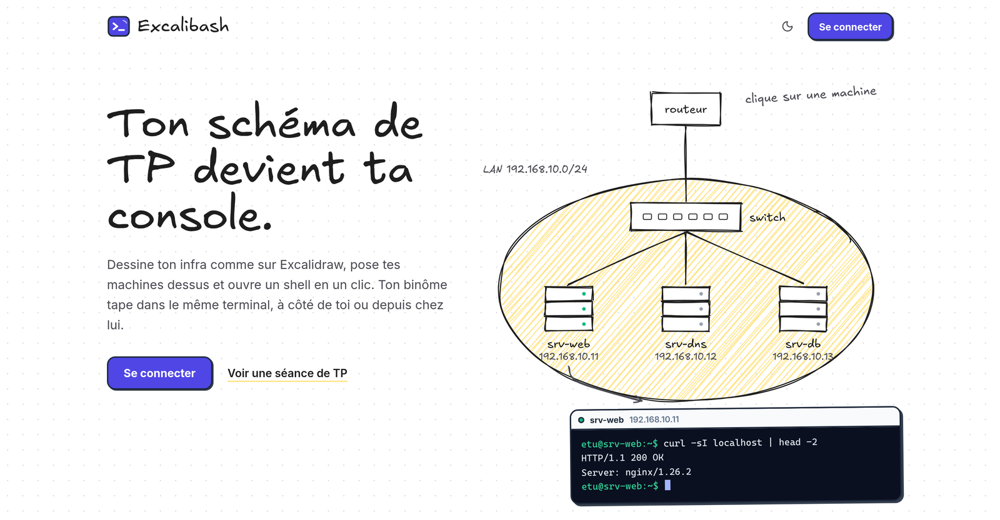

<p align="center">
  
</p>

<h1 align="center">Excalibash</h1>

<p align="center">
  Des tableaux Excalidraw avec de vrais terminaux dessus.<br>
  On dessine le schéma réseau du TP, on clique sur une machine, un shell s'ouvre.
</p>

<p align="center">
  <a href="https://excalibash.fr"><b>excalibash.fr</b></a>
</p>

<p align="center">
  <a href="https://excalibash.fr"></a>
  <a href="LICENSE"></a>
  
  
</p>


Tout le TP tient sur un seul tableau, partagé avec le binôme ou le prof. Les dessins, les noms et les terminaux sont chiffrés dans le navigateur : le serveur ne stocke et ne relaie que des données illisibles.

## Fonctionnalités

- **Terminaux sur le canvas.** Une icône de machine porte un ou plusieurs shells, chacun dans sa fenêtre. L'icône se personnalise avec la bibliothèque Excalidraw. <kbd>Alt</kbd>+<kbd>T</kbd> ouvre un shell, <kbd>Alt</kbd>+<kbd>R</kbd> ou un double-clic sur la barre de titre le masque sans l'arrêter.
- **Sites web des machines.** `http://127.0.0.1:80`, l'interface d'un routeur ou un Proxmox du réseau de la machine s'ouvrent dans une fenêtre du tableau ou en plein onglet. Le serveur ne voit ni l'adresse ni les pages.
- **Collaboration en temps réel.** Dessin, curseurs, sélections et terminaux partagés.
- **Dossiers partagés.** Partage en lecture ou en édition ; les sous-dossiers suivent. Retirer quelqu'un renouvelle toutes les clés du sous-arbre.
- **Machines.** Agent Go statique (Linux, macOS, amd64, arm64) qui se connecte en sortie, sans port à ouvrir. Appairage par code court, démarrage avec la machine, reconnexion automatique.
- **Comptes.** Le mot de passe ne quitte pas le navigateur et une clé de récupération est remise à l'inscription. Les inscriptions se font sur invitation ou sont ouvertes à tous, avec vérification par email. Le panneau d'administration gère les comptes et le stockage sans accès au contenu.

<table>
  <tr>
    <td></td>
    <td></td>
  </tr>
</table>

## Démarrage rapide

```bash
git clone https://github.com/excalibash-fr/excalibash.git
cd excalibash
docker compose up -d --build
```

L'application répond sur <http://localhost:6767>. Le premier compte créé est administrateur ; il demande le code d'installation affiché dans les logs :

```bash
docker compose logs excalibash | grep "Code d'installation"
```

La clé de récupération affichée à l'inscription est le seul moyen de retrouver un compte après un mot de passe oublié : personne ne peut le réinitialiser, l'administrateur non plus.

Les inscriptions sont fermées par défaut. Elles s'ouvrent dans **Administration → Inscriptions ouvertes à tous** ; sinon, l'administrateur crée des liens d'invitation.

## Configuration

Les variables se placent dans un fichier `.env` à côté de `docker-compose.yml` (ignoré par git).

| Variable | Défaut | Rôle |
|---|---|---|
| `PUBLIC_URL` | URL de la requête | URL publique, utilisée dans les commandes d'installation de l'agent |
| `PROXY_URL` | même hôte, port 6768 | URL publique de l'origine séparée des tunnels web |
| `COOKIE_SECURE` | `false` | `true` derrière HTTPS (obligatoire en production) |
| `SMTP_HOST` `SMTP_PORT` `SMTP_SECURE` `SMTP_USER` `SMTP_PASS` `SMTP_FROM` | vide, `587`, `false` | envoi des codes de vérification. Sans `SMTP_HOST`, les emails ne sont pas vérifiés. `SMTP_SECURE=true` pour le port 465 |
| `CONTACT_EMAIL` `LEGAL_NAME` | vide | contact affiché sur la page Confidentialité |
| `REGISTRATIONS_PER_HOUR` | `50` | plafond global d'inscriptions par heure |
| `BIND_ADDR` | `127.0.0.1` | interface où les ports sont publiés. `0.0.0.0` pour un accès direct depuis le réseau, en HTTP |
| `SETUP_CODE` | aléatoire | code exigé pour créer le premier compte (affiché dans les logs s'il n'est pas fixé) |
| `TRUST_PROXY` | réseaux locaux | proxys dont l'en-tête `X-Forwarded-For` est cru (format Express `trust proxy`) |

## Mise en production

Excalibash se sert en HTTPS, sur deux noms d'hôte : un pour l'application, un pour les tunnels web. Cette origine séparée empêche les sites ouverts dans un tunnel d'accéder aux clés.

Exemple avec [Caddy](https://caddyserver.com) :

```
excalibash.example.com {
  reverse_proxy localhost:6767
}
tunnel.example.com {
  reverse_proxy localhost:6768
}
```

```dotenv
PUBLIC_URL=https://excalibash.example.com
PROXY_URL=https://tunnel.example.com
COOKIE_SECURE=true
```

Par défaut, `docker-compose.yml` ne publie les ports 6767 et 6768 que sur `127.0.0.1` : seul le reverse proxy, en 80 et 443, est exposé. Le volume `excalibash-data` contient toutes les données ; son contenu est chiffré.

## Ajouter une machine

Dans **Machines → Ajouter avec un code**, Excalibash affiche une commande courte à lancer sur la machine :

```bash
curl -fsSL https://excalibash.example.com/p/7KQ4FD | sh
```

L'agent génère sa clé sur place et affiche son empreinte, à comparer avec celle d'Excalibash avant de valider. Le code expire après 10 minutes et ne sert qu'une fois.

L'agent est ensuite installé pour démarrer avec la machine : service système en root, service utilisateur avec *linger* sinon, `@reboot` dans la crontab sans systemd.

**Par copier-coller** donne une commande complète, avec une clé générée dans le navigateur.

## Sécurité

Le modèle de chiffrement, ce que le serveur voit et ses limites sont décrits dans [docs/SECURITY.md](docs/SECURITY.md). En bref :

- le serveur voit des métadonnées : emails, noms d'affichage, forme de l'arborescence, qui partage avec qui, dates et tailles ;
- comme toute application web chiffrée de bout en bout, Excalibash dépend du JavaScript servi : un serveur compromis pourrait le modifier, d'où l'intérêt de l'héberger soi-même en HTTPS ;
- la lecture seule est appliquée par le serveur, pas par la cryptographie : un lecteur détient la clé du dossier.

Les failles se signalent par une [alerte de sécurité privée](https://github.com/excalibash-fr/excalibash/security/advisories/new), pas dans une issue publique.

## Développement

Prérequis : Node 24+ et Go 1.24+.

```bash
make -C agent dist
(cd server && npm install)
(cd web && npm install && npm run build)
PORT=6767 DATA_DIR=./data-dev node server/src/index.ts
```

`npm run dev` dans `web/` lance Vite avec rechargement à chaud (port 5173, proxifié vers 6767).

```
agent/   agent Go : PTY, chiffrement des flux, tunnels web, reconnexion
server/  Node 24 + TypeScript natif : Express, ws, node:sqlite (relais aveugle)
web/     React + Vite : WebCrypto, tableau de bord, Excalidraw, xterm.js
tests/   scénario de bout en bout
```

```bash
(cd agent && go test ./...)
./tests/run.sh
```

## Remerciements

[Excalidraw](https://github.com/excalidraw/excalidraw) et [xterm.js](https://github.com/xtermjs/xterm.js) (MIT). Idée inspirée de [sshx](https://github.com/ekzhang/sshx) et d'ExcaliDash. Liste complète des composants tiers et de leurs licences : [THIRD_PARTY_NOTICES.md](THIRD_PARTY_NOTICES.md).

## Licence

[GNU AGPL-3.0](LICENSE).
