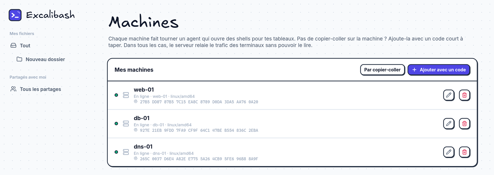

<p align="center">
  
</p>

<h1 align="center">Excalibash</h1>

<p align="center">
  Des tableaux Excalidraw avec de vrais terminaux dessus.<br>
  On dessine le schéma réseau du TP, on clique sur une machine, un shell s'ouvre.
</p>

<p align="center">
  <a href="https://excalibash.fr"><b>excalibash.fr</b></a>
</p>

<p align="center">
  <a href="https://excalibash.fr"></a>
  <a href="LICENSE"></a>
  
  
</p>


Tout le TP tient sur un seul tableau, partagé avec le binôme ou le prof. Les dessins, les noms et les terminaux sont chiffrés dans le navigateur : le serveur ne stocke et ne relaie que des données illisibles.

## Fonctionnalités

- **Terminaux sur le canvas.** Une icône de machine porte un ou plusieurs shells, chacun dans sa fenêtre. L'icône se personnalise avec la bibliothèque Excalidraw. <kbd>Alt</kbd>+<kbd>T</kbd> ouvre un shell, <kbd>Alt</kbd>+<kbd>R</kbd> ou un double-clic sur la barre de titre le masque sans l'arrêter.
- **Telnet et SSH vers les équipements.** Un switch, un routeur ou un PC joignable depuis une machine s'ouvre en Telnet, SSH ou TCP brut dans un terminal du tableau. Le client est intégré à l'agent. L'option « Équipement ancien » réactive les vieux algorithmes SSH (`diffie-hellman-group1-sha1`, `ssh-rsa`, CBC) qui provoquent les erreurs « no matching key exchange method found ».
- **Sites web des machines.** `http://127.0.0.1:80`, l'interface d'un routeur ou un Proxmox du réseau de la machine s'ouvrent dans une fenêtre du tableau ou en plein onglet. La configuration avancée accepte un en-tête Host et le TLS 1.0/1.1 des vieux équipements. Le serveur ne voit ni l'adresse ni les pages.
- **Collaboration en temps réel.** Dessin, curseurs, sélections et terminaux partagés.
- **Dossiers partagés.** Partage en lecture ou en édition ; les sous-dossiers suivent. Retirer quelqu'un renouvelle toutes les clés du sous-arbre.
- **Machines.** Agent Go statique (Linux, macOS, amd64, arm64) qui se connecte en sortie, sans port à ouvrir. Appairage par code court, démarrage avec la machine, reconnexion automatique.
- **Comptes.** Le mot de passe ne quitte pas le navigateur et une clé de récupération est remise à l'inscription. Les inscriptions se font sur invitation ou sont ouvertes à tous, avec vérification par email. Le panneau d'administration gère les comptes et le stockage sans accès au contenu.

<table>
  <tr>
    <td></td>
    <td></td>
  </tr>
</table>

## Démarrage rapide

```bash
git clone https://github.com/excalibash-fr/excalibash.git
cd excalibash
docker compose up -d --build
```

L'application répond sur <https://localhost:6767>, avec un certificat auto-signé (voir [HTTPS](#https)). Le premier compte créé est administrateur ; il demande le code d'installation affiché dans les logs :

```bash
docker compose logs excalibash | grep "Code d'installation"
```

La clé de récupération affichée à l'inscription est le seul moyen de retrouver un compte après un mot de passe oublié : personne ne peut le réinitialiser, l'administrateur non plus.

Les inscriptions sont fermées par défaut. Elles s'ouvrent dans **Administration → Inscriptions ouvertes à tous** ; sinon, l'administrateur crée des liens d'invitation.

## Configuration

Les variables se placent dans un fichier `.env` à côté de `docker-compose.yml` (ignoré par git).

| Variable | Défaut | Rôle |
|---|---|---|
| `PUBLIC_URL` | URL de la requête | URL publique, utilisée dans les commandes d'installation de l'agent |
| `PROXY_URL` | même hôte, port 6768 | URL publique de l'origine séparée des tunnels web |
| `TLS` | `auto` | `auto` : HTTPS sur les deux ports, avec le certificat fourni ou un certificat auto-signé. `off` : HTTP seul, derrière un reverse proxy qui fait le TLS |
| `TLS_CERT` `TLS_KEY` | vide | chemins PEM d'un certificat fourni (Let's Encrypt, PKI interne), utilisé à la place du certificat auto-signé |
| `TLS_SANS` | vide | noms ou adresses IP supplémentaires du certificat auto-signé, séparés par des virgules |
| `COOKIE_SECURE` | `false` | `true` force l'attribut `Secure` des cookies. Inutile en HTTPS direct ou derrière un proxy qui transmet `X-Forwarded-Proto` |
| `SMTP_HOST` `SMTP_PORT` `SMTP_SECURE` `SMTP_USER` `SMTP_PASS` `SMTP_FROM` | vide, `587`, `false` | envoi des codes de vérification. Sans `SMTP_HOST`, les emails ne sont pas vérifiés. `SMTP_SECURE=true` pour le port 465 |
| `CONTACT_EMAIL` `LEGAL_NAME` | vide | contact affiché sur la page Confidentialité |
| `REGISTRATIONS_PER_HOUR` | `50` | plafond global d'inscriptions par heure |
| `BIND_ADDR` | `127.0.0.1` | interface où les ports sont publiés. `0.0.0.0` pour un accès direct depuis le réseau |
| `SETUP_CODE` | aléatoire | code exigé pour créer le premier compte (affiché dans les logs s'il n'est pas fixé) |
| `TRUST_PROXY` | réseaux locaux | proxys dont l'en-tête `X-Forwarded-For` est cru (format Express `trust proxy`) |

## HTTPS

Excalibash exige HTTPS : hors de `localhost`, le navigateur refuse la cryptographie (WebCrypto) d'une page servie en HTTP. L'instance parle donc HTTPS dès le premier démarrage, sur les ports 6767 et 6768. Une requête en HTTP clair est redirigée vers HTTPS sur le même port.

Sans certificat fourni (`TLS_CERT`, `TLS_KEY`), le serveur en génère un, auto-signé, dans `DATA_DIR/tls/`. Ses noms couvrent `localhost`, le nom et les adresses IP de la machine, les hôtes de `PUBLIC_URL` et `PROXY_URL`, et `TLS_SANS`. Dans un conteneur, le nom et les adresses vus par le serveur sont ceux du conteneur : ceux de l'hôte se déclarent dans `TLS_SANS` (par exemple `TLS_SANS=excalibash.lan,192.168.1.20`).

Au premier accès, le navigateur affiche un avertissement. Avant de l'accepter, comparer l'empreinte SHA-256 du certificat (dans les détails de l'avertissement) avec celle des logs :

```bash
docker compose logs excalibash | grep "empreinte"
```

Les commandes d'installation de l'agent épinglent la clé publique de ce certificat (`curl --pinnedpubkey`, `excalibash-agent --pin`) : elles ne dépendent pas de l'avertissement du navigateur. La clé est conservée quand les noms changent, ce qui garde les agents installés valides.

Les tunnels web reposent sur un Service Worker, que les navigateurs refusent sur un certificat non reconnu, même après l'avertissement. Il faut alors installer le certificat de l'instance (`https://<hôte>:6767/certificate.pem`, aussi proposé dans la fenêtre du site) dans le navigateur ou le système, puis recharger.

## Mise en production

En production, Excalibash se sert sur deux noms d'hôte : un pour l'application, un pour les tunnels web. Cette origine séparée empêche les sites ouverts dans un tunnel d'accéder aux clés. Deux possibilités :

- un certificat reconnu passé à l'instance (`TLS_CERT`, `TLS_KEY`), valable pour les deux noms ;
- un reverse proxy qui fait le TLS, avec `TLS=off` sur l'instance (ou un proxy qui joint l'instance en HTTPS).

Exemple avec [Caddy](https://caddyserver.com) :

```
excalibash.example.com {
  reverse_proxy localhost:6767
}
tunnel.example.com {
  reverse_proxy localhost:6768
}
```

```dotenv
PUBLIC_URL=https://excalibash.example.com
PROXY_URL=https://tunnel.example.com
TLS=off
COOKIE_SECURE=true
```

Par défaut, `docker-compose.yml` ne publie les ports 6767 et 6768 que sur `127.0.0.1` : seul le reverse proxy, en 80 et 443, est exposé. Le volume `excalibash-data` contient toutes les données ; son contenu est chiffré.

## Ajouter une machine

Dans **Machines → Ajouter avec un code**, Excalibash affiche une commande courte à lancer sur la machine :

```bash
curl -fsSL https://excalibash.example.com/p/7KQ4FD | sh
```

L'agent génère sa clé sur place et affiche son empreinte, à comparer avec celle d'Excalibash avant de valider. Le code expire après 10 minutes et ne sert qu'une fois.

L'agent est ensuite installé pour démarrer avec la machine : service système en root, service utilisateur avec *linger* sinon, `@reboot` dans la crontab sans systemd.

**Par copier-coller** donne une commande complète, avec une clé générée dans le navigateur.

## Sécurité

Le modèle de chiffrement, ce que le serveur voit et ses limites sont décrits dans [docs/SECURITY.md](docs/SECURITY.md). En bref :

- le serveur voit des métadonnées : emails, noms d'affichage, forme de l'arborescence, qui partage avec qui, dates et tailles ;
- comme toute application web chiffrée de bout en bout, Excalibash dépend du JavaScript servi : un serveur compromis pourrait le modifier, d'où l'intérêt de l'héberger soi-même en HTTPS ;
- la lecture seule est appliquée par le serveur, pas par la cryptographie : un lecteur détient la clé du dossier.

Les failles se signalent par une [alerte de sécurité privée](https://github.com/excalibash-fr/excalibash/security/advisories/new), pas dans une issue publique.

## Développement

Prérequis : Node 24+ et Go 1.24+.

```bash
make -C agent dist
(cd server && npm install)
(cd web && npm install && npm run build)
PORT=6767 DATA_DIR=./data-dev node server/src/index.ts
```

`npm run dev` dans `web/` lance Vite avec rechargement à chaud (port 5173, proxifié vers `https://127.0.0.1:6767` ; `BACKEND` change la cible).

```
agent/   agent Go : PTY, chiffrement des flux, tunnels web, reconnexion
server/  Node 24 + TypeScript natif : Express, ws, node:sqlite (relais aveugle)
web/     React + Vite : WebCrypto, tableau de bord, Excalidraw, xterm.js
tests/   scénario de bout en bout
```

```bash
(cd agent && go test ./...)
./tests/run.sh
```

## Remerciements

[Excalidraw](https://github.com/excalidraw/excalidraw) et [xterm.js](https://github.com/xtermjs/xterm.js) (MIT). Idée inspirée de [sshx](https://github.com/ekzhang/sshx) et d'ExcaliDash. Liste complète des composants tiers et de leurs licences : [THIRD_PARTY_NOTICES.md](THIRD_PARTY_NOTICES.md).

## Licence

[GNU AGPL-3.0](LICENSE).
